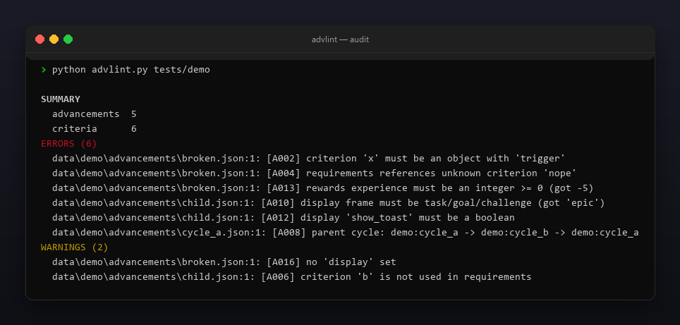
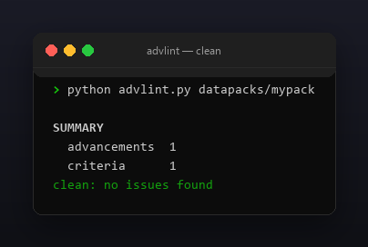

<p align="center"></p>

<p align="center">
  <a href="README.ru.md"></a>
  <a href="https://github.com/Celine1337/advlint/releases"></a>
  <a href="https://github.com/Celine1337/advlint/actions/workflows/ci.yml"></a>
  <a href="LICENSE"></a>
</p>


Validator for Minecraft datapack advancement JSON. A broken advancement simply
never unlocks, and a parent cycle can make a whole tab vanish. advlint reads your
`data/<ns>/advancements/` (or `advancement/`) tree and flags the problems before
you load the pack:

- criteria without a `trigger`, unknown triggers, requirements pointing at
  criteria that do not exist;
- parent links that form cycles (including self-parents), bad parent ids;
- display blocks missing title / description / icon, bad `frame`, non-boolean
  flags, roots without a `background`;
- rewards with negative experience or malformed loot / recipe / function ids.

Single file, standard library only, Python 3.9+.


- Reconstructs each advancement's resource id from its path
  (`data/<ns>/advancements/...`) and builds the parent graph across the tree.
- Detects parent cycles with a depth-first walk, reporting the whole loop.
- Knows the vanilla trigger ids; unknown ones are warnings so modded triggers
  do not fail the build.
- Scans one advancement file or a whole datapack tree.
- `--json` machine-readable report; exit code `1` on errors for CI gating;
  `--strict` also fails on warnings.
- Colored ANSI output, `--no-color` and `NO_COLOR`.


| Code | Severity | Meaning |
|------|----------|---------|
| A000 | error | unreadable file, invalid JSON, or not an object |
| A001 | error | `criteria` missing / empty / not an object |
| A002 | error | criterion not an object or missing `trigger` |
| A003 | warning | unknown trigger id |
| A004 | error | `requirements` references an unknown criterion |
| A005 | error | `requirements` not a list of lists of names |
| A006 | warning | criterion not used in `requirements` |
| A007 | error | invalid `parent` id |
| A008 | error | parent cycle across the tree (or self-parent) |
| A009 | error | display missing title / description / icon, or bad text |
| A010 | error | display `frame` not task / goal / challenge |
| A011 | error | display icon missing a valid item id |
| A012 | error | display show_toast / announce_to_chat / hidden not boolean |
| A013 | error | rewards experience negative / not an integer |
| A014 | error | rewards loot / recipes not a list of valid ids |
| A015 | error | rewards function not a valid id |
| A016 | warning | no `display` set |
| A017 | error | root advancement with display but no `background` |


```console
$ python advlint.py datapacks/mypack/data/mypack/advancements/root.json
$ python advlint.py datapacks/mypack      # whole tree, parent cycles
$ python advlint.py datapacks/mypack --json
```

```
SUMMARY
  advancements  5
  criteria      6
ERRORS (6)
  data/demo/advancements/broken.json:1: [A002] criterion 'x' must be an object with 'trigger'
  data/demo/advancements/broken.json:1: [A004] requirements references unknown criterion 'nope'
  data/demo/advancements/broken.json:1: [A013] rewards experience must be an integer >= 0 (got -5)
  data/demo/advancements/child.json:1: [A010] display frame must be task/goal/challenge (got 'epic')
  data/demo/advancements/child.json:1: [A012] display 'show_toast' must be a boolean
  data/demo/advancements/cycle_a.json:1: [A008] parent cycle: demo:cycle_a -> demo:cycle_b -> demo:cycle_a
WARNINGS (2)
  data/demo/advancements/broken.json:1: [A016] no 'display' set
  data/demo/advancements/child.json:1: [A006] criterion 'b' is not used in requirements
```

Exit codes: `0` — clean (or warnings only), `1` — errors (or warnings with
`--strict`), `2` — bad path.

Limits, on purpose: it validates structure and the parent graph, not trigger
semantics — it cannot know whether a criterion is actually achievable in game.







```console
$ python -m unittest discover -s tests -v
```

29 tests cover criteria, requirements, the parent graph and cycles, display,
rewards and exit codes. The demo and all images are regenerable:

```console
$ python tools/make_demo.py       # tests/demo with one of each issue
$ pip install pillow
$ python tools/make_shots.py      # docs/audit.png, docs/clean.png
$ python tools/make_style.py tools/style.json docs/style
```


[MIT](LICENSE) © Celine1337