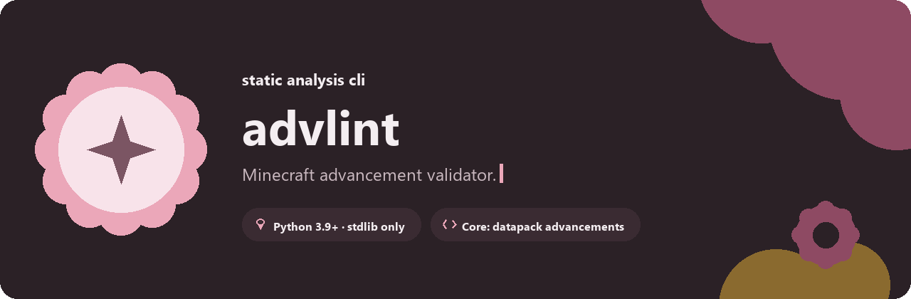
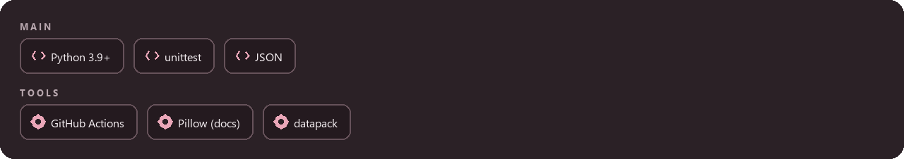
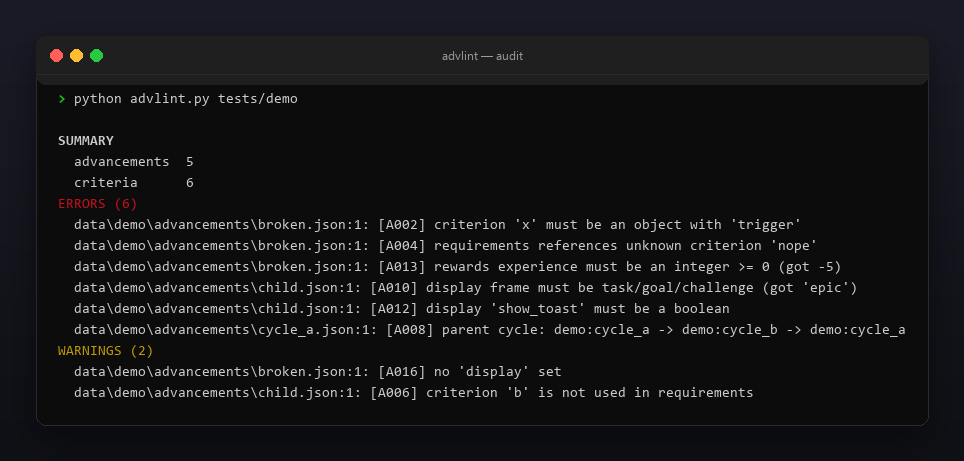
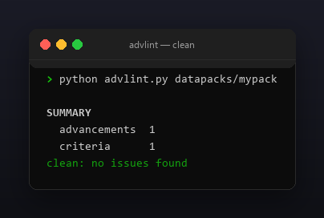

<p align="center"></p>

<p align="center">
  <a href="README.md"></a>
  <a href="https://github.com/Celine1337/advlint/releases"></a>
  <a href="https://github.com/Celine1337/advlint/actions/workflows/ci.yml"></a>
  <a href="LICENSE"></a>
</p>


Валидатор JSON-достижений (advancements) датапаков Minecraft. Сломанное
достижение просто никогда не открывается, а цикл родителей может убрать целую
вкладку. advlint читает дерево `data/<ns>/advancements/` (или `advancement/`) и
находит проблемы до загрузки пака:

- критерии без `trigger`, неизвестные триггеры, requirements, ссылающиеся на
  несуществующие критерии;
- ссылки parent, образующие циклы (включая self-parent), плохие id parent;
- блоки display без title / description / icon, плохой `frame`, не-boolean
  флаги, корни без `background`;
- награды с отрицательным опытом или кривыми id loot / recipe / function.

Один файл, только стандартная библиотека, Python 3.9+.


- Восстанавливает resource-id каждого достижения из пути
  (`data/<ns>/advancements/...`) и строит граф родителей по всему дереву.
- Находит циклы родителей обходом в глубину, показывая всю петлю.
- Знает ванильные id триггеров; неизвестные — предупреждения, чтобы модовые
  триггеры не валили сборку.
- Сканирует один файл достижения или целое дерево датапака.
- `--json` — машинный отчёт; код `1` при ошибках для CI-гейта; `--strict`
  валит и на предупреждениях.
- Цветной ANSI-вывод, `--no-color` и `NO_COLOR`.


| Код | Уровень | Смысл |
|-----|---------|-------|
| A000 | ошибка | нечитаемый файл, неверный JSON или не объект |
| A001 | ошибка | `criteria` нет / пуст / не объект |
| A002 | ошибка | критерий не объект или без `trigger` |
| A003 | предупр. | неизвестный id триггера |
| A004 | ошибка | `requirements` ссылается на неизвестный критерий |
| A005 | ошибка | `requirements` не список списков имён |
| A006 | предупр. | критерий не используется в `requirements` |
| A007 | ошибка | невалидный id `parent` |
| A008 | ошибка | цикл родителей по дереву (или self-parent) |
| A009 | ошибка | у display нет title / description / icon или плохой текст |
| A010 | ошибка | `frame` у display не task / goal / challenge |
| A011 | ошибка | у icon display нет валидного id предмета |
| A012 | ошибка | show_toast / announce_to_chat / hidden у display не boolean |
| A013 | ошибка | опыт в rewards отрицательный / не целое |
| A014 | ошибка | loot / recipes в rewards не список валидных id |
| A015 | ошибка | function в rewards не валидный id |
| A016 | предупр. | не задан `display` |
| A017 | ошибка | корневое достижение с display, но без `background` |





```console
$ python advlint.py datapacks/mypack/data/mypack/advancements/root.json
$ python advlint.py datapacks/mypack      # всё дерево, циклы родителей
$ python advlint.py datapacks/mypack --json
```

```
SUMMARY
  advancements  5
  criteria      6
ERRORS (6)
  data/demo/advancements/broken.json:1: [A002] criterion 'x' must be an object with 'trigger'
  data/demo/advancements/broken.json:1: [A004] requirements references unknown criterion 'nope'
  data/demo/advancements/broken.json:1: [A013] rewards experience must be an integer >= 0 (got -5)
  data/demo/advancements/child.json:1: [A010] display frame must be task/goal/challenge (got 'epic')
  data/demo/advancements/child.json:1: [A012] display 'show_toast' must be a boolean
  data/demo/advancements/cycle_a.json:1: [A008] parent cycle: demo:cycle_a -> demo:cycle_b -> demo:cycle_a
WARNINGS (2)
  data/demo/advancements/broken.json:1: [A016] no 'display' set
  data/demo/advancements/child.json:1: [A006] criterion 'b' is not used in requirements
```

Коды возврата: `0` — чисто (или только предупреждения), `1` — ошибки (или
предупреждения с `--strict`), `2` — неверный путь.

Ограничения сознательные: он валидирует структуру и граф родителей, а не
семантику триггеров — не может знать, достижим ли критерий в игре.







```console
$ python -m unittest discover -s tests -v
```

29 тестов покрывают критерии, requirements, граф родителей и циклы, display,
награды и коды возврата. Демо и все картинки перегенерируются:

```console
$ python tools/make_demo.py       # tests/demo с по одной каждой проблеме
$ pip install pillow
$ python tools/make_shots.py      # docs/audit.png, docs/clean.png
$ python tools/make_style.py tools/style.json docs/style
```


[MIT](LICENSE) © Celine1337